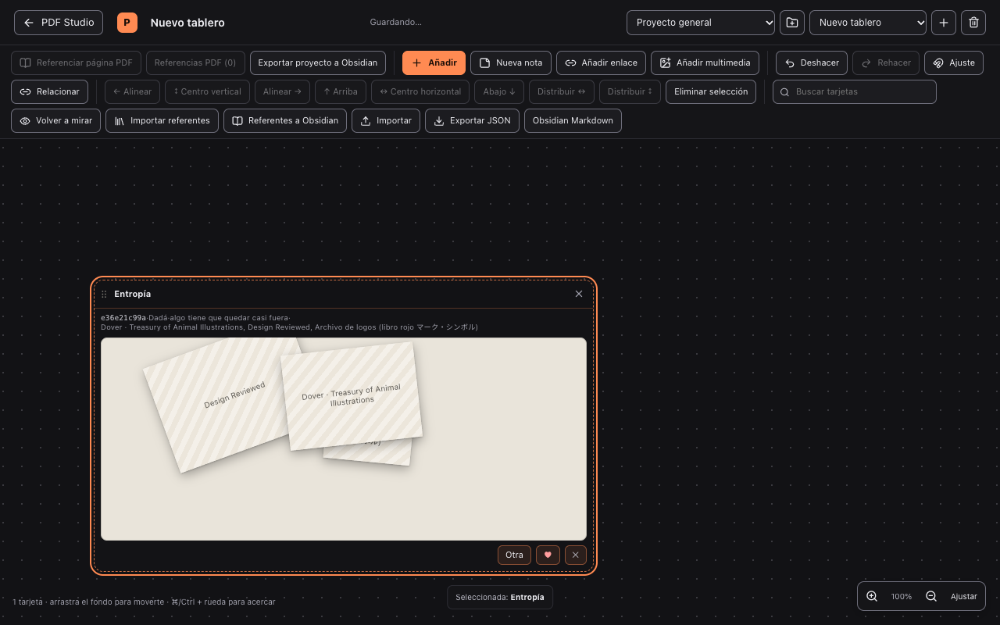
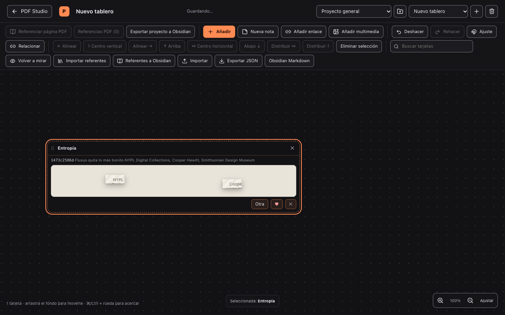
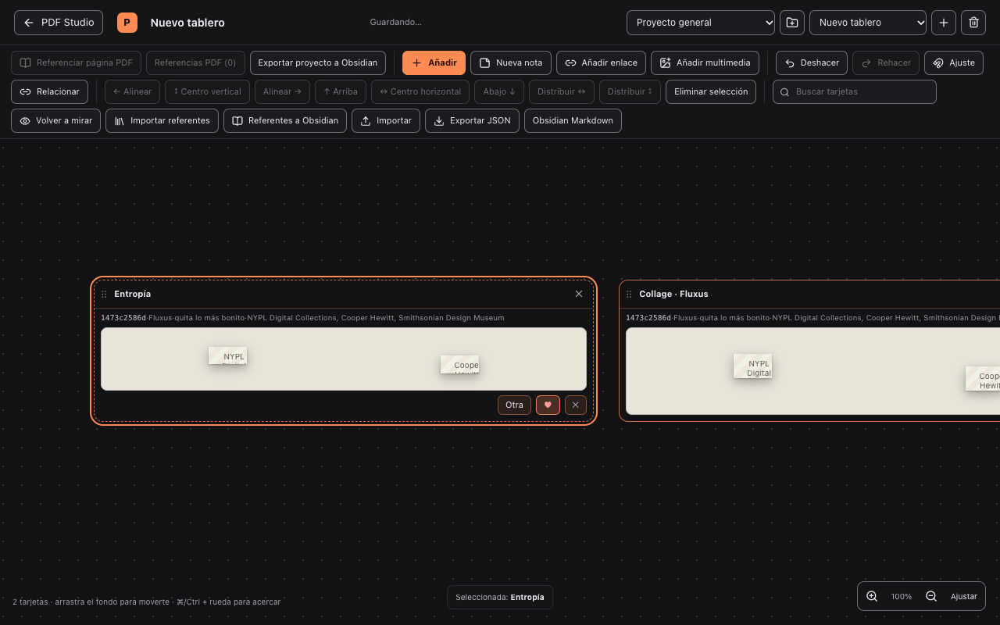

# Reporte V-3 · Herramienta «Entropía» en la pizarra

| Campo | |
|---|---|
| Fase actual | V-3 (herramienta de marco Entropía + gusto ♥/✕ + guardado con procedencia) |
| Rama | `studio/collage` |
| Paso 0 | `6a278c7142eadb23b3c1dd0f48326e1576073a5f` — `studio: reglas de collage puras (V-2)` |
| Verificación | Las 4 comprobaciones dentro de `studio/frontend` en RC=0: `npx tsc -b`, `npx vitest run` (22 archivos, 118 tests), `npx oxlint` (14 avisos previos, 0 errores) y `npx vite build`. Además, el E2E de Playwright `e2e-l1/entropia.spec.ts` pasa. |
| Integridad | V-3 **sin commit y sin push**. Sin dependencias nuevas. Sin tocar `studio-desktop` ni el backend. |
| Coste | ~589 líneas nuevas en 6 archivos + 308 inserciones / 30 borrados en 6 archivos modificados. ~1 h 20 min de sesión, estimación de reloj, no cronometrada. |

## 1. Qué se hizo

**Nuevo**

- `studio/frontend/src/board/vanguardia/entropia.ts` — lógica pura de la tirada:
  - `nuevaSemilla()` (10 hex), `tirarEntropia()` y `normalizarEntropia()`.
  - Reutiliza `combinar()` y `aplicarRegla()` de V-1/V-2; no duplica reglas ni pesos.
  - La tirada guarda **semilla, regla, restricción, herramienta, ids de fuentes y la disposición completa**. Por eso el collage se rehace idéntico y no depende de volver a tirar.
- `studio/frontend/src/board/vanguardia/restricciones.ts` — 12 restricciones propias, al modo de Oblique Strategies.
- `studio/frontend/src/board/tools/entropia.tsx` — herramienta registrada con `id: 'entropia'`, `tipo: 'marco'`, icono e importación/exportación Markdown de la procedencia.
- `studio/frontend/src/board/tools/entropiaVista.tsx` — la Vista: encabezado gris pequeño, lienzo, recorte, rotación, ♥ ✕ y «Otra».
- `studio/frontend/src/tests/entropia.test.ts` — 5 tests puros.
- `studio/frontend/e2e-l1/entropia.spec.ts` — E2E real con Playwright + Brave.

**Modificado**

- `board/tools/registry.ts` — una línea de registro; el menú «Añadir / + Más» se arma solo desde el registro.
- `components/BoardWorkspace.tsx` — rama de marco para Entropía; referentes de todo el proyecto como fuentes; Tirar/Otra/♥/✕; guardado de la tarjeta copia.
- `components/board.css` — estilos del collage y del marco.
- `board/projectModel.ts` y `board/projectStorage.ts` — los gustos ahora viven en `BoardProject.gustos` y se escriben con `saveProjectGustos()`. Los proyectos viejos se normalizan a memoria vacía; no hay migración destructiva.
- `tests/boardTools.test.tsx` — el registro pasa de 6 a 7 herramientas.

## 2. Cómo funciona

1. En el menú «+ Añadir» aparece **Entropía**. Se elige y se dibuja el marco arrastrando, como cualquier marco.
2. **Tirar**: pide una combinación con los referentes de todo el proyecto (no solo del tablero abierto). Toma `imagenes[0]` de cada referente y aplica la regla elegida por el combinador.
3. Encabezado superior, en gris y pequeño: **semilla · regla · restricción · fuentes**.
4. **Otra** genera semilla nueva y vuelve a tirar.
5. **♥** crea una tarjeta nueva al lado del marco con la disposición copiada y procedencia (`semilla`, `regla`, `restriccion`, `fuentes`) y suma 1 a los gustos del proyecto.
6. **✕** solo resta 1 a los gustos; no toca el collage ni crea tarjeta.
7. Al recargar, el marco vivo y la tarjeta guardada se pintan desde los datos guardados: misma semilla y misma geometría.

Decisiones:

- La tarjeta guardada es un **marco** con `datos.guardado = true`. Comparte el tipo de tarjeta del marco para no inventar otra herramienta en el registro; su vista es de solo lectura.
- Los ids de las fuentes se guardan, no las imágenes duplicadas. La imagen se resuelve desde el referente del proyecto al pintar. Si el referente se borra, queda la procedencia y el hueco con su nombre.
- Si un referente no tiene imagen, se pinta un bloque con su nombre. No se inventan imágenes ni URLs.
- La semilla se genera al tirar y se conserva; no se regenera al repintar.
- `♥` y `✕` usan `like()`/`nope()` de V-1, con el mismo recorte `[0.2, 5]`.

## 3. Verificación real

### Las 4 comprobaciones (dentro de `studio/frontend`)

```
$ npx tsc -b
RC=0

$ npx vitest run
 Test Files  22 passed (22)
      Tests  118 passed (118)

$ npx oxlint
 RC=0; 14 warnings, 0 errors.
 Son los mismos 14 avisos previos de V-2; ninguno en entropía.

$ npx vite build
 dist/index.html                   0.46 kB │ gzip:   0.30 kB
 dist/assets/index-Qzjuik0R.css   63.95 kB │ gzip:  12.62 kB
 dist/assets/index-B7rqo9XF.js   484.57 kB │ gzip: 149.94 kB
 ✓ built in 533ms
```

### Test Playwright

```
$ npx playwright test -c playwright.l1.config.ts entropia.spec.ts
 ✓ V-3: tres tiradas y ♥ deja una tarjeta con la última semilla
 1 passed
```

El E2E hace exactamente lo pedido:

1. Importa los referentes del proyecto.
2. Crea un tablero vacío y dibuja un marco Entropía.
3. Tira una vez y pulsa «Otra» dos veces (3 tiradas).
4. Comprueba que las tres semillas tienen forma de semilla.
5. Pulsa ♥ y verifica que hay **1** tarjeta guardada y que su `data-semilla` es la última tirada.
6. Lee IndexedDB y comprueba que el proyecto recibió los gustos (≥2 referentes y 1 regla).
7. Guarda 3 capturas.

### Capturas







**Aviso honesto sobre las capturas:** la biblioteca semilla no trae imágenes adjuntas, así que las piezas salen como bloques rayados con el nombre del referente. La ruta de imagen sí está implementada y se usa en cuanto el referente tiene `imagenes[0]`; las capturas no lo demuestran, solo demuestran la disposición, el recorte geométrico y la procedencia.

### Nivel de evidencia

- **SPEC** en el contrato de la herramienta, el registro y la procedencia pedida.
- **E1** en las 4 comprobaciones y en el E2E: observado en esta máquina.
- **E1** en la persistencia de gustos: leído desde IndexedDB en el E2E.
- **E0** en la mirada estética con imágenes reales: no hay referentes con imagen en la semilla; falta esa prueba de ojo.
- **H1** en que las 7 reglas se lean como su vanguardia al verlas; la geometría está probada, la lectura estética no.

## 4. Límites que quedan (dichos, no tapados)

- **No hay botón «repetir esta semilla»** en la UI. La repetición idéntica está garantizada por los datos guardados y por el test puro, pero no se ofrece como gesto aparte. Si lo quieres, es un botón más.
- **El collage no usa las dimensiones reales de la imagen**: `aspecto` se asume 1 porque los referentes no guardan ancho/alto. El recorte y la rotación se respetan; el encuadre fino puede mejorar cuando el referente guarde dimensiones.
- **Sin imágenes en la semilla**: los 12 referentes importados no traen archivo. Para ver Entropía con imágenes hay que añadirlas a mano.
- **Las restricciones son texto**: no se interpretan visualmente («solo dos colores» no cambia los colores). Igual que en V-2, el dato viaja y se muestra, pero la Vista no lo ejecuta.
- **La tarjeta guardada se puede mover y borrar como un marco**. No se anida dentro de otro marco.
- **Gustos de proyectos viejos**: se normalizan a vacío. No se ha migrado ninguna memoria anterior porque no existía.
- **El E2E usa Brave instalado**, no descarga navegadores de Playwright.

## 5. Integridad

- No se borró ni renombró ningún archivo existente.
- No se añadieron dependencias.
- No se tocó `studio/backend`, `studio-desktop` ni el esquema del tablero (`schemaVersion` sigue en 1).
- `dist/` se regeneró por el build (ignorado por git).
- El único commit de la sesión es el Paso 0: `6a278c7142eadb23b3c1dd0f48326e1576073a5f`.
- V-3 queda **sin commit y sin push**.
- No hay claves ni `.env` en los archivos nuevos.

## 6. Avance

- **V-3: 100 %** — base: herramienta registrada, Tirar/Otra/♥/✕, procedencia, gustos en proyecto, 5 tests puros, E2E de 3 tiradas + ♥ y las 4 comprobaciones en RC=0. Fase contada.
- **Vanguardia como producto usable: 70 %** — base: combinador, gustos, 7 reglas, registro y UI de Entropía; faltan imágenes reales en la semilla, el gesto de repetir semilla y la mirada estética. Fase contada, no ponderada por tamaño.
- **Proyecto entero**: no hay inventario de fases en el material que se me pidió leer; no invento la cifra.

## 7. Lo que tienes que hacer tú

1. Abre `REPORTES/capturas/entropia-1-tirada.png` y `entropia-3-guardado.png`: mira si la disposición y el marco te sirven antes de tocar nada.
2. Para verlo con imágenes de verdad: abre Prometeo → Tablero → Importar referentes, doble clic en un referente, «Añadir imagen», Guardar. Repite en 2-3 referentes.
3. Crea un tablero vacío, Añadir → Entropía, dibuja el marco, pulsa Tirar tres veces y luego ♥. Comprueba que la tarjeta nueva conserva la semilla del encabezado.
4. Decide si quieres un cuarto botón «Misma semilla» (repetir sin cambiar) o si basta con la tarjeta guardada.
5. Dime si el encabezado gris se lee bien a tamaño real; si no, subo el tamaño o parto la línea.

